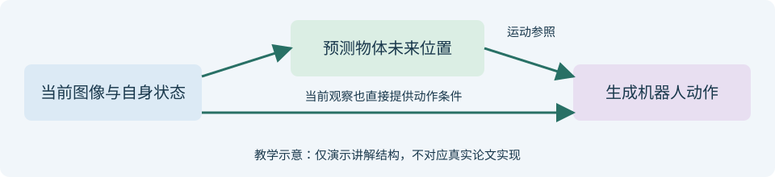

<!-- paper-reading-lang: zh-CN -->
<!-- paper-reading-theme: cobalt -->
<!-- paper-reading-mode: brief -->
# 教学示例：先想杯子去哪，再决定手怎么动

```paper-map
{"thesis":"把“未来物体位置”当作动作生成的一份参照，看看怎样把方法讲具体。","items":[{"number":"01","label":"输入","text":"桌面图像和机械臂当前状态。","source":"本页教学构造，非论文结论"},{"number":"02","label":"中间计划","text":"预测杯子接下来应处于什么位置。","source":"本页教学构造，非论文结论"},{"number":"03","label":"输出","text":"结合图像与计划，生成机械臂动作。","source":"本页教学构造，非论文结论"}]}
```

**这是虚构的简化教学例子，用于展示项目的页面、公式和流程图能力，不是一篇真实论文的阅读结果。** 本页没有实验性能声明。

## 1 / 问题定义

桌上有一个杯子，希望机械臂把它向右移动。输入是当前图像和关节状态，输出是下一段动作。我们用这个小问题示范如何解释一个“预测未来再指导动作”的方法。

## 2 / 核心假设

教学模型假设杯子的粗位置足以帮助选动作，精细接触仍需看图像。这是例子中的简化条件，没有实验支持其普适性。

## 3 / 贡献拆解

这个例子多加了一个预测物体未来位置的分支。是否提高成功率需要真实实验；画出分支本身不能说明它有效。

## 4 / 方法框架

先看图中的上方路径：图像给出当前杯子位置，预测分支提出未来位置，然后把这份运动参照交给动作分支。再看下方直连路径：动作仍能直接读取当前观察，不会只凭一份预测盲目行动。



*教学绘图；不代表某篇论文的具体网络。*

用一维位置举例：杯子在$x=1$，希望移到$x=3$，位移参照为：

$$
\Delta x=x_{\mathrm{target}}-x_{\mathrm{current}}=3-1=2.
$$

这里的2表示杯子位置应改变的量，**不是机械臂某个关节应该转2度**。动作分支还要根据自身姿态和图像生成实际命令。这个区别能避免把“物体计划”和“机器人动作”混为一谈。

<details class="reading-detail">
<summary>为什么不能直接把位移当作关节动作</summary>

同样向右移动杯子，机械臂当前姿态不同，所需关节变化也不同。物体位移只是动作生成的目标参照，具体命令仍需要模型或控制器给出。

</details>

## 5 / 实验审查

本例没有数据集、训练和实测结果。真正阅读论文时，需要看动作分支单独运行和加入预测分支后的比较条件是否一致。

## 6 / 主结果与消融

本例没有测量。可以提出“移除预测分支后表现如何”的问题，但不能凭图示替实验回答。

## 7 / 局限与失败模式

若杯子被夹爪遮住或预测位置错误，运动参照可能误导动作；这是根据教学模型推断的可能情况，不是已观察到的失败率。

## 8 / 最弱环节

没有实验说明动作分支是否真的使用了位置预测。

## 9 / 可复现清单

本页公式和图示可以复算、重绘；没有提供真实训练模型或机器人程序。

## 10 / 对用户任务的建议

把自己的方法代入这张图：说明中间表示是什么、下游怎样读取它，再找一个样本走完流程。只画模块名称时容易忽略的信息，通常会在这一步显现。
